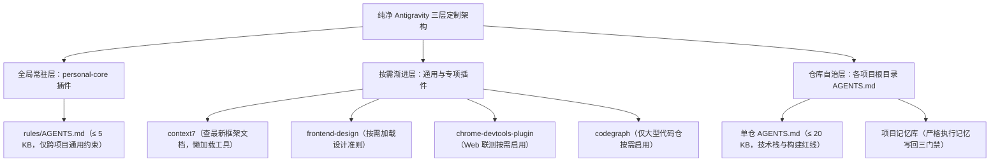

# 新电脑 Antigravity 零副作用优化参考与避坑指南

本文面向**网络顺畅、无内网特殊代理包袱**的新电脑环境。目标是在零历史包袱、零上下文污染的前提下，把旧电脑上真正验证有效的协作方式与工程机制保留下来，直接获得比旧机更轻、更稳、更顺手的 Antigravity 使用体验。

> [!IMPORTANT]
> **核心原则：只带走方法论、协作纪律、插件分层架构与记忆治理门禁；彻底抛弃旧机的系统/网络/盘符补丁和运行态缓存。**

## 仓库目录

- `README.md` — 本指南全文（开荒清单、选型矩阵、迁移红黑榜与避坑指南）
- `plugins/personal-core/` — 可直接复制到 `~/.gemini/config/plugins/personal-core/` 的纯净版全局规则插件
- `templates/project-AGENTS.md` — 可直接复制到新项目根目录的仓库级规范骨架



---

## 一、新机 5 步开荒落地清单

1. **全新安装最新版 Antigravity**
   - 直接安装官方最新客户端，**不要复制旧机 `~/.gemini/antigravity/` 运行态目录**（如 `conversations/`、`cache/`、`plugin_data/`、`antigravity_state.pbtxt`、`installation_id`），避免触发登录态错乱与版本残留冲突。
2. **在 UI 中开启高自主权运行档位**
   - 在 Antigravity Settings 界面开启高自主权限预设（`TURBO` 档）、命令自动执行（`EAGER`）、跨工作区文件读写放行（按需）以及 `swarm` 协同能力；高风险和线上不可逆操作交由规则层兜底要求人工确认。
   - **重要**：所有插件开关与权限调整一律通过 UI 操作，**不要在运行期手动编辑 `~/.gemini/config/config.json`**，否则会绕过 Language Server 热重载，还可能覆盖并发中的权限授权配置。
3. **部署纯净版 `personal-core` 插件**
   - 将本仓库的 `plugins/personal-core/` 复制或软链到 `~/.gemini/config/plugins/personal-core/`（若后续在本地填入个人隐私背景或项目记忆，建议改用私有仓库同步）。
4. **从官方 Marketplace 重装通用插件，按场景启用专项插件**
   - 必装 `context7`（专治框架/库版本 API 幻觉）。
   - 做 UI 或 Web 开发时，启用 `frontend-design`（从旧机仅迁移 `SKILL.md` 即可）与 `chrome-devtools-plugin`。
   - 维护中大型代码仓库时，再单独开启 `codegraph`。
5. **仓库级规矩全部下沉到各项目根目录 `AGENTS.md`**
   - 让 Antigravity 随当前工作区自动发现并加载（项目级配置优先级高于全局配置），单个文件控制在 **≤ 20 KB**。
   - 个人项目可将 `AGENTS.md` 正常提交进 Git；若某仓库不希望把个人说明推到远端，直接写入该仓的 `.git/info/exclude` 即可本地隔离。

---

## 二、可直接复制的纯净版配置模板（零副作用）

### 1. 插件目录结构

放置路径：`~/.gemini/config/plugins/personal-core/`

```text
~/.gemini/config/plugins/personal-core/
├── plugin.json       # 必需：插件元数据与全局唯一标识
├── README.md         # 可选：给开发者看的说明（不会进入 Agent 上下文）
├── rules/
│   └── AGENTS.md     # 核心：纯 Markdown，无 YAML frontmatter，启用插件即常驻生效
└── skills/           # 可选：按需存放个人工作流技能或筛选后的个人项目记忆技能
```

### 2. `plugin.json` 模板

```json
{
  "name": "personal-core",
  "displayName": "Personal Core Rules",
  "version": "1.0.0",
  "description": "跨项目通用协作原则、工程纪律、中文文案规范与四通道知识治理门禁（纯净跨平台版）。",
  "suggestedPrompts": [
    "按轻量 SDD 先出改动方案与验证步骤",
    "检查本次改动前是否已核对仓内先例与生效渲染路径",
    "将本次沉淀的可复用项目结论按门禁写入记忆库"
  ]
}
```

### 3. 纯净版 `rules/AGENTS.md` 完整模板

以下模板约 3～4 KB，完全去除了旧机代理地址、本机工具路径和旧公司业务路由，可直接作为新机的全局规则全文使用：

````markdown
# 全局协作规范与知识治理

本规则随 `personal-core` 插件启用，仅约束跨项目通用协作方式、工程纪律与知识沉淀口径；具体项目的技术栈、命令与业务边界以所在工作区根目录的 `AGENTS.md` 为准。

---

## 1. 身份、语言与沟通方式

- **始终使用简体中文回复**（所有项目、所有场景均如此）。
- **个人背景边界（本地按需补充）**：可在此写明你的所在地区、业务范围或默认免追问的前提条件，避免模型每次套用错误默认假设。
- **少追问、带假设推进**：能自行查证或按常识定夺的事直接带假设往下做。仅在以下三类情况才停下来请用户拍板：
  1. 决策偏差会导致明显做废工作；
  2. 需求超出当前范围，涉及跨仓改动或架构升级（需明确列出 scope delta）；
  3. 涉及线上高风险或不可逆变更（正式发布部署、新建线上云资源、删库或远程数据库迁移）。

---

## 2. 工程与交付纪律

- **轻量 SDD（先对齐方案，再一路执行）**：
  - 跨多文件的复杂功能先出简要计划或 spec（落到项目 `specs/`），用户批准后连续推进至验证收尾；
  - 单文件小改直接动手完成，不堆砌形式主义流程；
  - 编写长文档时先搭完整骨架，再逐节填充细节。
- **先核实后动手、先复核后汇报**：
  - 修改代码前先查清仓内已有 canonical 先例与约定模式，优先复用现有抽象；
  - 修改 UI 逻辑前，必须先确认目标组件或文件确实处在生效渲染路径上；
  - 测试或构建失败时严禁一句「非本方案引起」一笔带过，必须查明并说明真实根因。
- **跨平台编码与换行保护**：
  - 编辑已有文件时，严格保留原文件的换行风格（LF / CRLF）与文件编码（禁止无故剥离 UTF-8 BOM）。
- **工具选用单一职责**：
  - 优先复用现成的本机 CLI（如 Git / GitHub CLI `gh`）与 Antigravity 原生能力（如内置 `browser` subagent 处理实时网页查看与 UI 交互）；
  - 仅当当前仓库存在 `.codegraph/` 索引目录时，优先调用 `codegraph` 追踪符号定义、调用链与影响面。

---

## 3. 通用文案规范（写给人看的字）

1. **改前先指错**：修改已有界面或文档文案前，先指出原句问题（规则错误、丢失信息、读不通顺、事实过期），说不出具体问题就不按个人口味随意重写。
2. **用词统一**：专业术语与交互按钮名称向界面及行业常用词靠拢，不自造生词。
3. **风格服务目的**：自然简洁不等于禁止准确书面词，但必须杜绝翻译腔（如用「它」代指人、硬凑主语、直译英文词条）。
4. **事实对齐代码**：文案中涉及的数量限制、校验规则与实际行为，必须对照代码常量与真实逻辑编写，不得凭记忆估算。

---

## 4. 四通道知识分工与记忆写回门禁

### 四通道分工

| 知识类型 | 唯一存放位置 | 读取与维护方式 |
| --- | --- | --- |
| 代码结构、符号定义与调用链 | 实时源码 / CodeGraph | 现查现用，不靠历史记忆背诵 |
| 仓库架构红线、构建与测试命令 | 仓库根目录 `AGENTS.md` | 控制在 ≤ 20 KB，随代码库维护 |
| 隐蔽业务口径、历史设计原因、外部坑点 | 项目记忆库（如有） | 按需精准检索，遵守下方写回三门禁 |
| 跨项目通用习惯纠偏与工作流 | 全局 `AGENTS.md` 或 `/learn` | 保持精简，避免膨胀 |

### 记忆写回三门禁（仅沉淀可长期复用的高价值结论）

1. **三不写**：
   - 不写读源码或查 CodeGraph 即可直接确认的纯实现细节、易变行号；
   - 不写一次性单号/流水、瞬时数据库或开关状态、待提交或待发布清单；
   - **严禁写入任何明文密码、API Key、Token 或私钥**。
2. **先查后写、合并优先**：
   - 写入前先检索是否已有同类专题；有覆盖则原地更新纠偏，无匹配才新建精简专题 `.md`（含 YAML frontmatter `name` / `description` / `type`，只记结论、原因与入口符号）并同步更新索引行。
3. **显式报备**：
   - 每次新增或更新记忆后，在回复末尾用一行说明改动的文件路径与核心结论，方便随时审阅或叫停。
````

### 4. 配套：项目根目录 `AGENTS.md` 精简骨架模板

每个具体项目在自己仓库根目录放一份，单文件控制在 20 KB 以内，把与项目强绑定的命令和红线都放在这里：

```markdown
# <项目名称> 开发规范

## 技术栈与常用命令
- 包管理 / 运行时：<如 pnpm / uv / dotnet>
- 本地启动：<dev 命令>
- 校验命令：<lint / typecheck / test / e2e 命令>

## 目录结构与架构红线
- 入口与核心模块：<说明主要目录职责>
- 不变量与禁忌：<不可破坏的数据约束、前后端契约、回滚底线>

## 联测与发布约束
- 本地联测方式：<测试账号、端口、预检查方式>
- 高风险操作：<远程迁移、生产发布、新建云资源前须经人工确认>
- 版本库规则：<Git 分支/提交规范，或是否使用特定忽略清单>
```

---

## 三、插件与工具链选型矩阵

| 插件 / 能力 | 获取方式 | 何时启用 | 上下文开销 | 核心价值与分工定位 |
| --- | --- | --- | --- | --- |
| `personal-core` | 自建插件（模板见上） | **始终启用** | 极低（规则 ≤ 5 KB） | 固化个人沟通风格、工程纪律、文案标准与知识治理门禁 |
| `context7` | 官方 Marketplace | **强烈推荐常驻** | 极低（懒加载工具 + 按需 Skill） | 实时拉取最新框架/SDK 文档与代码示例，专治版本 API 幻觉 |
| `frontend-design` | 自建 Skill 插件（迁自旧机） | **做前端/产品 UI 时常驻** | 几乎为零（渐进披露，触发才加载） | 提供高审美前端视觉方向与微文案准则，避免 AI 模板化界面 |
| `chrome-devtools-plugin` | 官方 Marketplace | **做 Web 联测与性能排查时启用** | 极低（按需 Skill） | 辅助 Chrome DevTools 排查 LCP、内存泄漏、a11y 与 Cookie 状态 |
| `codegraph` | 独立 MCP 插件 | **仅维护建有 `.codegraph/` 的大仓时启用** | 极低（单核心工具） | 追踪复杂仓库符号关系、调用链与重构影响面，减少盲搜文件 |

> [!TIP]
> **明确不建议默认挂载的冗余项**：
> - **不挂 GitHub MCP**：日常操作直接用本机 `gh` CLI，更稳定且省工具槽位。
> - **不挂独立 Playwright MCP**：实时看页面、点交互走 Antigravity 内置 `browser` subagent；自动化回归直接运行项目自带的 E2E 脚本。
> - **默认不挂手工 `chrome-devtools-isolated` MCP**：该配置会一次性挂载 30 多个浏览器工具定义；在新电脑上先以内置 `browser` subagent 为主，只有遇到必须“持久化独立测试登录态且免去手动授权点击”的场景时，再按需临时开启。

---

## 四、旧电脑资产迁移红黑榜

### 1. 白名单（直接带走或在新机重装最新版）

- 本文第二节整理好的**纯净版 `personal-core` 规则骨架**；
- `frontend-design` 插件目录（纯设计方法论 Skill，零环境绑定）；
- 新电脑上仍会继续开发维护的**个人项目**仓内 `AGENTS.md` 与经过筛选的项目记忆；
- 通过官方 Marketplace 在新机重新安装的 `context7`、`chrome-devtools-plugin`。

### 2. 黄名单（必须清洗去硬编码后再决定是否带走）

- **自定义记忆检索脚本（如有沿用需要）**：
  - 必须剔除硬编码盘符、用户名路径（如 `C:\Users\<username>\...`、`D:\Workspace\...` 这类带用户名和盘符的绝对路径）与特定平台命令（如写死单系统 Python 启动器）；
  - 改为基于脚本自身 `__file__` 相对路径与 `Path.home()` 动态定位目录，并同时兼容跨平台 Python 启动方式。

### 3. 黑名单（坚决不迁，迁了必产生负面作用）

1. **旧机 `~/.gemini/antigravity/` 整个运行态目录**：包含 `conversations/`、`cache/`、`plugin_data/`、`antigravity_state.pbtxt`、`installation_id`，跨机拷贝极易导致状态损坏与幽灵异常。
2. **旧机代理与网络特调规则**：如旧机特定的内网代理（`192.168.x.x` 代理）、本地代理端口、WSL2 宿主机 LAN IP 转发与域名直连补丁；在网络顺畅的新电脑上，这些全都是虚假先验，一旦网络稍有波动就会把 Agent 引向不存在的代理链路瞎排查。
3. **旧机单平台环境专属补丁**：如“强制禁用 `python`/`python3` 只准用特定启动器”、“写死编辑器绝对路径装插件”、“为绕过旧版 Node 版本管理工具 shim 而写死的壳层包装”。换到环境干净的 Windows 或 macOS/Linux 上，反而会直接报找不到命令。
4. **新机不再维护的旧公司项目路由表、专属 VCS 规定与历史交接快照**：把已经不碰的旧业务路由、一次性交接文件和庞大历史记忆全塞在新机上，只会白烧上下文、稀释注意力，甚至让模型把旧公司约束误套用到你的新项目里。

---

## 五、实测避坑指南（8 条高价值反模式）

1. **全局 `AGENTS.md` 越写越胖**
   - **坑的表现**：把项目规范、环境命令、临时备忘全往全局规则里堆。
   - **为什么伤体验**：每轮对话都会无条件注入系统上下文，指令越多，模型对每条指令的注意力越被稀释。
   - **正确做法**：全局规则严控在 **≤ 5 KB**，项目规范下沉到仓根 `AGENTS.md`（≤ 20 KB），多步骤操作流程封装为按需触发的 Skill。

2. **整包复制 `~/.gemini/antigravity/` 或保留旧版残留文件**
   - **坑的表现**：换机时把整个用户目录打包覆盖过去，图省事省登录。
   - **为什么伤体验**：运行态数据库、安装 ID、锁文件与插件缓存混在一起，容易出现工具注册异常、状态不同步或莫名报错。
   - **正确做法**：新机永远全新安装 Antigravity，只迁移 `~/.gemini/config/plugins/` 下干净的插件源码。

3. **运行期手工修改 `~/.gemini/config/config.json`**
   - **坑的表现**：直接用文本编辑器去改全局 `config.json` 开关插件或调整权限。
   - **为什么伤体验**：Antigravity 的 Language Server 有内置状态管理与热重载机制，手改文件既不会触发即时生效，还可能直接覆盖并发写入的权限配置。
   - **正确做法**：插件启用/禁用与权限预设全部在 Antigravity UI 内操作。

4. **自定义插件的 `name` 与其他插件全局撞车**
   - **坑的表现**：新建插件时随手起了和官方或已有插件相同的 `name`。
   - **为什么伤体验**：所有插件共享全局命名空间，一旦 `name` 冲突，先发现的插件会覆盖后者，被覆盖的插件会被**静默丢弃且无明显报错**。
   - **正确做法**：`plugin.json` 中的 `name` 使用明确的小写 kebab-case（例如 `personal-core`），创建前先确认现有插件清单不重名。

5. **同类工具多层叠加（MCP + CLI + 原生能力三路打架）**
   - **坑的表现**：同时开着 GitHub MCP、Playwright MCP、手工 DevTools MCP，外加原生浏览器和本地 CLI。
   - **为什么伤体验**：工具定义列表迅速膨胀，模型不仅会多耗上下文，还容易在等价工具间反复试错。
   - **正确做法**：坚持**一类能力保留最优一路**（GitHub 走 `gh` CLI，实时网页走内置 `browser` subagent，E2E 跑项目自带脚本）。

6. **规则或辅助脚本里写死绝对路径和单平台命令**
   - **坑的表现**：在 `SKILL.md` 或配套脚本里写死带盘符、用户名的绝对路径或单系统专属调用方式。
   - **为什么伤体验**：只要换电脑、换用户名或跨系统（Windows ↔ macOS），规则和脚本立刻变成死链。
   - **正确做法**：脚本内部统一用 `__file__` 相对路径与 `Path.home()`，规则文案里只写逻辑相对路径（如 `~/.gemini/config/...`）。

7. **记忆只写不治，演变成“过时幻觉源”**
   - **坑的表现**：把源码细节、精确行号、临时开关状态和一次性单号都记进记忆文件，后续代码一改就失效。
   - **为什么伤体验**：Agent 信任记忆里的旧事实，反而不去读最新源码，导致按过期结论改错代码。
   - **正确做法**：从第一天严守**三不写 + 先查后写合并优先**，定期归档或删除已完成的一次性计划与交接快照。

8. **stdio 型 MCP 被包管理器杂音日志打坏 / 代理长连超时被掐**
   - **坑的表现**：通过 `npx` 启动的本地 MCP 偶尔握手失败；或经过代理时跑长推理/长命令约 30 秒突然断流。
   - **为什么伤体验**：包管理器的升级提示或配置文件警告若输出到 stdout，会直接破坏 MCP 的 JSON-RPC 通信；代理过短的 `read_timeout` 则会让长任务频繁中断重试。
   - **正确做法**：只要配置了 `npx` 驱动的 stdio MCP，顺手在 `env` 中加静默参数（如 `"NPM_CONFIG_LOGLEVEL": "error"`）；新机若需经过任何网络代理，确认其空闲读超时设置足够宽裕（建议 ≥ 10～15 分钟）。

---

## 六、持续进化与跨机同步建议

### 1. 用 Git 仓库跨机同步个人插件层

脱敏后的通用规则和模板（如本仓库的 `plugins/personal-core/`）可放在公开仓库中，在新电脑随时拉取；一旦在本地填入了个人隐私、地区背景或项目记忆，建议改用**私有 Git 仓库**或仅在本地单独维护，软链或放到 `~/.gemini/config/plugins/` 下，以后每次调整只需要提交推送，另一台电脑 `git pull` 即可同步。

### 2. 新经验沉淀决策表（应该往哪放）

| 你刚发现的新经验类型 | 应该写入哪里 | 理由 |
| --- | --- | --- |
| 只在当前任务用一次的临时要求 | **不写入任何持久化配置** | 避免一次性指令污染后续对话 |
| 某项目的构建命令、模块边界或架构禁忌 | **该项目根目录 `AGENTS.md`** | 仅在该工作区生效，不拖累其他项目 |
| 某项目隐蔽的业务规则或历史设计坑点 | **该项目专属记忆库（遵守三门禁）** | 保持 `AGENTS.md` 精简，按需检索调阅 |
| 多步骤、可重复执行的专业工作流（如发版、联测套路） | **封装成独立 `SKILL.md`** | 利用渐进披露机制，平时不占正文上下文 |
| 跨所有项目都希望遵守的个人沟通或工程偏好 | **全局 `personal-core/rules/AGENTS.md` 或 `/learn`** | 保持最小集，高确定性全局生效 |

### 3. 日常高频斜杠命令速查

| 命令 | 适用场景 |
| --- | --- |
| `/plan` | 面对跨模块复杂改动，先对齐步骤与验证口径再动手 |
| `/grill-me` | 方案关键边界没想透时，让 Agent 通过交互式追问帮你把设计决策拍实 |
| `/learn` | 刚纠正完 Agent 的某个不当习惯或搞定复杂环境，把这条经验持久化 |
| `/compact` | 长对话上下文变重时主动压缩摘要，恢复推理响应速度 |
| `/boost` | 需要深度思考、多视角核验与严格自检的高难度研发任务 |
| `/teamwork` | 体量较大、适合拆给多个自主 Agent 协同推进的复杂工程 |
