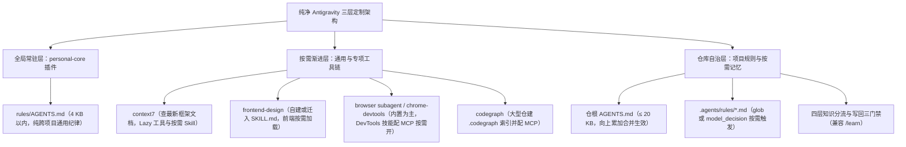

# 新电脑 Antigravity 零副作用优化参考与避坑指南

本文面向**网络顺畅、无内网特殊代理包袱**的新电脑环境，帮助你在零历史包袱、零上下文污染的前提下，把验证有效的协作纪律、插件分层架构与知识治理机制迁移到新机，获得比旧环境更轻、更稳、更可控的 Antigravity 使用体验。

> [!IMPORTANT]
> **核心原则：只带走方法论、协作纪律、插件分层架构与知识分流门禁；彻底抛弃旧机的运行态缓存、历史会话库与单机环境补丁。**

## 仓库目录（Single Source of Truth）

所有规则与配置模板均以仓内独立文件为唯一权威源，正文只做架构解读与选型说明，不重复粘贴整段文件内容，避免日后版本漂移：

- [`plugins/personal-core/plugin.json`](./plugins/personal-core/plugin.json) — `personal-core` v1.1.0 插件清单（含 `$schema` 与 `logo: "assets/logo.svg"`）
- [`plugins/personal-core/README.md`](./plugins/personal-core/README.md) — 插件内含组件与跨平台安装说明
- [`plugins/personal-core/assets/logo.svg`](./plugins/personal-core/assets/logo.svg) — 128×128 透明边距矢量图标（适配浅色/深色主题）
- [`plugins/personal-core/rules/AGENTS.md`](./plugins/personal-core/rules/AGENTS.md) — 全局核心规则（纯 Markdown、无 frontmatter、体积 `< 4 KB`，四层知识分流开箱兼容 `/learn`）
- [`templates/project-AGENTS.md`](./templates/project-AGENTS.md) — 仓库根目录 `AGENTS.md` 精简骨架模板
- [`templates/glob-rule-example.md`](./templates/glob-rule-example.md) — `.agents/rules/<topic>.md` 文件作用域与按需触发规则模板
- [`templates/plugins.json`](./templates/plugins.json) — 供 `~/.gemini/config/plugins.json` 使用的免拷贝 Git 同步配置模板
- [`templates/mcp-configs.example.json`](./templates/mcp-configs.example.json) — 按需启用的 `codegraph` 与 `chrome-devtools-isolated` MCP 参考配置
- [`LICENSE`](./LICENSE) — MIT 开源协议（对应 `plugin.json` 中的 `"license": "MIT"`）



---

## 一、新机 5 步开荒落地清单

### 1. 全新安装最新版 Antigravity（不搬旧机运行态）

- 直接安装官方最新客户端，**切勿复制旧机 `~/.gemini/antigravity/` 运行态目录**（包括 `conversations/`、`cache/`、`plugin_data/`、`antigravity_state.pbtxt`、`installation_id`）。
- 运行态数据库、设备标识与登录态混拷极易触发工具注册异常、状态错乱或幽灵报错。

### 2. 选对权限预设、终端沙箱与硬护栏（含 `swarm` 入口说明）

Antigravity Settings 提供 4 档统一的权限预设（Permission Presets），控制终端命令、文件访问与 MCP/Web 行为：

| 权限预设 | 终端沙箱（Terminal Sandbox） | 终端命令策略 | 文件读写范围 | MCP / Web | 适用定位 |
| --- | --- | --- | --- | --- | --- |
| `Request Review` | 关闭 | 每次都弹窗确认 | 仅当前工作区（修改前询问） | 询问 | 严格审查敏感变更 |
| `Default` | **开启** | 沙箱内自动执行；跳出沙箱需确认 | 工作区 + 临时目录 | 询问 | 出厂默认均衡档 |
| **`Auto`（推荐）** | **开启** | 沙箱内自动执行；**跳出沙箱时自动评估**，安全可逆放行、高风险仍确认 | 工作区 + 临时目录 | 询问 | **新机默认高自主推荐档** |
| `Turbo` | 关闭 | 无限制自动执行 | **全盘文件读写** | 自动放行 | 极限全自动（必须叠加硬护栏） |

- **推荐选择 `Auto` 档**：在 **Antigravity `v2.23+`（macOS / Linux）** 与 **`v2.26+`（Windows 个人账号）** 上默认可用，并默认开启 OS 原生终端沙箱（Linux `Namespaces` / macOS `sandbox-exec` / Windows 基于 **Process security environments (AppContainer)**）。注意：**Windows 端沙箱要求 Windows 11 24H2 及以上版本（2026-08 更新+）**；在 Windows 10 或未达标旧版 Windows 11 上因沙箱不可用，UI 不会提供 `Auto` 档，默认预设也会回退为 `Request Review`。在受支持环境中，`Auto` 在沙箱内免打扰运行；遇到需联网或访问工作区外的命令时，系统自动评估并放行安全可逆操作，危险或不可逆操作仍交由你确认。
- **关于 `Turbo` 档的准确边界**：`Turbo` **本身就已经**关闭沙箱、放开终端命令、授予全盘读写并自动放行 MCP 与 Web；**不需要**也**不要**再去叠加修改任何旧版或内部配置键（如 `EAGER`、`ALLOW`）。
- **硬护栏声明（关键安全认知）**：`AGENTS.md` 只是**软性提示词约束（soft prompt constraint）**，模型在复杂上下文下仍可能误触发越权操作。如果你选用 `Turbo` 档，**必须**额外配置硬性拦截手段：
  1. 在 Settings 中添加细粒度权限规则——所有自定义规则均按 **`Deny > Ask > Allow`** 优先级生效，**高于任何权限预设（含 `Turbo`）**，例如：`Deny: write_file(/Users/<user>/.ssh)`（或 `/home/<user>/.ssh`）、`Deny: write_file(.git/)`、`Deny: command(rm -rf)`、`Ask: command(git push --force)`（注意 `read_file`/`write_file` 不支持 `~/` 展开；Windows 评估前会自动剥离盘符如 `C:` 并把 `\` 转为 `/`，因此 `/Users/<user>/.ssh` 同样匹配 Windows 用户目录）；
  2. 或在插件/项目中配置 `PreToolUse` 生命周期钩子（`hooks.json`），在工具实际执行前以脚本代码返回 `"decision": "deny"` / `"ask"` / `"force_ask"` 硬拦截。
- **`swarm` 的正确开启位置**：`swarm` 是默认禁用的内置插件，**不在 Permissions 设置页里**。需要多 Agent 协同推进时，前往 **Customizations > Installed** 按需开启即可（实时生效；`/swarm` 在 Antigravity App 与 CLI 的 Pro / Ultra 套餐可用）。
- **严禁运行期手改 `~/.gemini/config/config.json`**：所有插件开关与权限规则一律通过 UI 或 `agy plugin enable/disable` 操作。运行期手改 `config.json` 会绕过 Language Server 热重载，还可能直接覆盖并发写入中的 `userSettings` 与权限授权。

### 3. 部署纯净版 `personal-core` 插件（3 种方式任选）

新机部署建议配合 Git 仓库做单源管理，以下 3 种方式等价，详情亦可对照 [`plugins/personal-core/README.md`](./plugins/personal-core/README.md)：

1. **Git 仓库免拷贝同步（推荐）**：
   - 将本仓库克隆到本地固定路径，在 `~/.gemini/config/plugins.json` 中通过 `entries` 指向克隆仓下的 `plugins` 目录（结构见 [`templates/plugins.json`](./templates/plugins.json)）。
   - **关键提醒**：`plugins.json` **不会自动展开 `~`**，路径必须写完整绝对路径（如 `/Users/yourname/dotfiles/antigravity-setup-guide/plugins` 或 `C:/Users/yourname/dotfiles/antigravity-setup-guide/plugins`）。之后跨机同步只需 `git pull`。
2. **官方 CLI 严格校验并安装**：
   ```bash
   agy plugin validate --strict ./plugins/personal-core
   agy plugin install ./plugins/personal-core
   ```
3. **直接拷贝或建立目录链接到 `~/.gemini/config/plugins/personal-core/`**：
   - macOS / Linux 可用 `ln -s /abs/path/to/plugins/personal-core ~/.gemini/config/plugins/personal-core`；
   - Windows 在普通用户权限下请用目录联接 **`mklink /J`**（不要用 `mklink /D`，符号链接在默认策略下需要管理员提权）。

部署后在 **Customizations > Installed** 确认 `personal-core` 处于开启状态（立即生效，无需重启）。若需填入个人地区背景或私有前提，请仅在本地维护或迁入私有 Git 仓库，切勿把隐私信息或密钥推入公开仓库。

### 4. 重装通用插件，理清内置浏览器与专项工具边界

- **必装常驻 `context7`**：从官方 Marketplace 安装（`antigravity-plugins-partners/plugin/context7`），专治框架/SDK 版本 API 幻觉。
- **日常网页验证优先用内置 `browser` subagent（注意可用边界）**：
  - **Antigravity App `v2.30+` + 个人 Google 账号**（逐步灰度发布中）提供零配置开箱即用的内置侧边栏浏览器；
  - 若使用 **Antigravity CLI（`agy`）**、**IDE 扩展**，或 **企业/工作区账号**，则需准备本地 **Node.js（`npx` 在 `PATH` 中）+ Google Chrome `v144+`**，并在 Chrome 地址栏打开 `chrome://inspect/#remote-debugging` 勾选允许远程调试（首次 `/browser` 连接时需在 60 秒内点击 Chrome 弹窗中的 **Allow**）。
- **`chrome-devtools-plugin` 必须配套 `chrome-devtools-mcp` 按需使用**：
  - 官方 Marketplace 中的 `chrome-devtools-plugin` **仅包含 6 个调试 Skills，本身不自带任何 MCP Server**。绝不要以为单开它就能操控浏览器；
  - 只有需要 **LCP Trace 性能剖析、Heap Snapshot 堆内存快照、CSS 层叠计算排查**，或需要**持久化独立测试 Chrome Profile 登录态**时，才按 [`templates/mcp-configs.example.json`](./templates/mcp-configs.example.json) 配置 `chrome-devtools-mcp`（示例中的 `chrome-devtools-isolated`）并与 `chrome-devtools-plugin` 配合使用。
  - Antigravity 会将 MCP 工具注册为 **Lazy tools（懒加载工具）**：初始系统提示词中只注入工具名称列表，完整 JSON Schema 在模型实际调用时才按需读取。平时依然建议关闭 `chrome-devtools-isolated`，核心目的是**避免与内置 `browser` subagent 产生浏览器工具路由重叠与二选一抖动**。
- **`frontend-design` 的真实来源**：它是自定义 / 从旧机迁移的 `SKILL.md` 插件，**并非官方 Marketplace 插件**。全新电脑在 Marketplace 中搜不到它，需自行迁入个人沉淀的 `SKILL.md` 或新建对应 Skill。
- **`codegraph` 需走完「CLI + 索引 + MCP」三步闭环**：
  1. 在本机安装 `codegraph` CLI；
  2. 在目标大型代码仓根目录生成 `.codegraph/` 索引；
  3. 在 `~/.gemini/config/mcp_config.json` 中配置 `codegraph` MCP（见 [`templates/mcp-configs.example.json`](./templates/mcp-configs.example.json)）。
  - **Windows 升级提醒**：在 Windows 上升级 `codegraph` 二进制前，必须先停止所有运行中的 `codegraph` MCP 进程，避免原生模块 `kernel.node` 因文件占用锁导致升级失败。

### 5. 仓库规则下沉与渐进式分片（厘清累加语义与扫描边界）

- **核心纠偏：Rules 是「累加合并（Cumulative）」，不是「覆盖（Override）」**
  - **Skills 与 Custom Agents** 才按优先级覆盖（仓内个人定制目录（若配置了 `.gemini/config.json` 的 `personal_customization_dir`） / 从 CWD 向上至 `.git` 的 `.agents/` > 工作区 `skills.json` / `plugins.json` > 全局 `~/.gemini/config/` > 内置 > 全局 JSON 配置）。另注意：**`agy` CLI 还会以最高用户级优先级读取 `~/.gemini/antigravity-cli/skills/` 与 `~/.gemini/skills/`，而桌面 App 不会扫描这两个路径**，因此跨端共享的个人技能务必统一放在 `~/.gemini/config/skills/` 或插件内。
  - **Rules** 会将插件规则、全局规则与仓库规则**同时累加注入上下文**（仅按真实路径去重），项目 `AGENTS.md` **不会**覆盖掉全局规则里的矛盾指令。因此全局 `personal-core/rules/AGENTS.md` 绝不写具体技术栈默认项，技术栈与命令全部下沉到各项目根目录 `AGENTS.md`。
- **官方长度与预算硬上限**：
  - 单文件上限 **`24,000 bytes`**（展开 `@[label]` 内嵌文件引用后按行边界截断），仓库根 `AGENTS.md` 建议控制在 **`<= 20 KB`**；
  - 全局规则与 `always_on` 规则共享 **`20,000 tokens`** 聚合预算（超出预算的文件会降级为文件路径指针，由模型按需自行读取；仅内置插件豁免）。
- **发现与扫描边界**：
  - Antigravity 从当前工作区目录（CWD）**向上遍历至仓库根目录（`.git`）**加载规则与 `.agents/`，**绝不会向下钻取子目录**（例如打开 Monorepo 根目录时，不会自动加载 `packages/web/AGENTS.md`）；
  - `.agents/rules/` 与 `.agents/skills/` 默认只扫描**一层深（one level deep）**，嵌套子目录需通过 `.agents/rules.json` / `.agents/skills.json` 显式列出。
- **渐进式分片实践**：
  - 从 [`templates/project-AGENTS.md`](./templates/project-AGENTS.md) 复制一份到新项目根目录（不希望推到远端时可写入 `.git/info/exclude` 本地隔离）；
  - 当专项规范增多时，拆入 `.agents/rules/<topic>.md`，使用 `trigger: glob`（搭配带引号的逗号分隔字符串 `globs`）或 `trigger: model_decision`，详见 [`templates/glob-rule-example.md`](./templates/glob-rule-example.md)。注意：**缺少 YAML frontmatter、误用驼峰触发器（如 `alwaysOn` / `modelDecision`）或把 `globs` 写成 YAML 数组，会导致规则被静默丢弃**。

---

## 二、仓库内置模板与插件结构说明

### 1. `personal-core` 插件（v1.1.0）

位于 `plugins/personal-core/`，结构精简、零环境硬编码：

```text
plugins/personal-core/
├── plugin.json       # v1.1.0 清单（含 $schema 与 logo: assets/logo.svg）
├── README.md         # 组件清单与 3 种安装方式
├── assets/
│   └── logo.svg      # 128×128 矢量图标（满足 agy plugin validate --strict 零提示）
└── rules/
    └── AGENTS.md     # 纯 Markdown（无 frontmatter，约 3 KB），启用插件即常驻生效
```

[`plugins/personal-core/rules/AGENTS.md`](./plugins/personal-core/rules/AGENTS.md) 仅约束跨项目通用准则，分为 4 部分：
1. **身份、语言与沟通方式**：全场景简体中文回复、可选本地个人背景槽位（附防泄密提醒）、低打扰假设推进与三类高风险停顿边界；
2. **工程与交付纪律**：轻量 SDD（多文件先对齐方案再执行、单文件直接改、长文档先骨架后填肉）、先核实仓内先例与生效 UI 渲染路径、测试失败追根因、保留原文件编码与 LF/CRLF、工具单一职责（`git`/`gh`、内置 `browser` subagent、`codegraph_explore`）；
3. **通用中文文案规范**：改前先指错、术语对齐界面标准、杜绝翻译腔、数值与校验口径严格对齐源码常量；
4. **四层知识分流与沉淀三门禁**：原生兼容 `/learn` 与项目记忆目录（无任何外部 Python 归档脚本依赖），明确区分实时源码、仓根/分片规则、按需 Skill 与隐蔽业务/环境坑点，并保留「三不写、先查后写合并优先、显式报备」三门禁。

### 2. `templates/` 配套模板清单

- [`templates/project-AGENTS.md`](./templates/project-AGENTS.md)：项目根目录 `AGENTS.md` 骨架，涵盖技术栈命令、模块边界与不变量、联测与高风险确认、VCS 规范，并内附 24,000 bytes 上限、累加合并原则与向上扫描说明。
- [`templates/glob-rule-example.md`](./templates/glob-rule-example.md)：`.agents/rules/<topic>.md` 范例，演示合法的 `snake_case` frontmatter（`trigger: glob` 搭配 `"*.sql, db/migrations/*.ts"`，附 `model_decision` 与 `manual` 对照示例）。
- [`templates/plugins.json`](./templates/plugins.json)：面向 `~/.gemini/config/plugins.json` 的 Git 免拷贝同步模板（示例绝对路径结构，使用前替换为本机实际路径）。
- [`templates/mcp-configs.example.json`](./templates/mcp-configs.example.json)：按需挂载的 `codegraph` 与 `chrome-devtools-isolated`（含 `"NPM_CONFIG_LOGLEVEL": "error"`）示例片段，合并到 `~/.gemini/config/mcp_config.json` 即可。

---

## 三、插件与工具链选型矩阵

| 插件 / 能力 | 获取方式 | 何时启用 | 工具加载与上下文特性 | 核心价值与分工定位 |
| --- | --- | --- | --- | --- |
| `personal-core` | 本仓自建插件（[`plugin.json`](./plugins/personal-core/plugin.json)） | **始终启用** | 常驻纯规则（`< 4 KB`） | 固化个人沟通风格、工程纪律、文案标准与四层知识分流门禁 |
| `context7` | 官方 Marketplace | **强烈推荐常驻** | Lazy 工具 + 按需 Skill | 实时拉取最新框架/SDK 文档与代码示例，专治版本 API 幻觉 |
| `frontend-design` | 自建 / 旧机迁入 `SKILL.md`（**非 Marketplace**） | **做前端/产品 UI 时常驻** | 渐进披露（触发才读全文） | 提供高审美视觉方向与微文案准则，避免模板化界面 |
| `chrome-devtools-plugin` + `chrome-devtools-mcp` | 官方 Marketplace（6 个 Skills）+ [`mcp-configs.example.json`](./templates/mcp-configs.example.json) | **仅做深度性能/内存/CSS 排查或需独立持久化测试 Profile 时启用** | Skills 渐进披露 + MCP Lazy 工具 | 排查 LCP Trace、Heap Snapshot、CSS 层叠或维持独立测试浏览器登录态 |
| `codegraph` | `codegraph` CLI + `.codegraph/` 索引 + MCP | **仅维护已建索引的中大型仓库时启用** | MCP Lazy 工具 | 追踪复杂仓库符号关系、调用链与重构影响面，减少盲搜文件 |
| `swarm` | 内置插件（**Customizations > Installed** 开启） | **需要多 Agent 并行拆解任务时开启** | 内置协同能力（默认禁用） | 编排多 Agent 并行研发、评审与验证 |

> [!TIP]
> **明确不建议默认挂载的冗余项**：
> - **不挂 GitHub MCP**：日常操作直接用本机 `gh` CLI，更稳定且不和本地 Git/CLI 抢工具路由。
> - **不挂独立 Playwright MCP**：实时看页面、点交互优先走内置 `browser` subagent；自动化回归直接运行项目自带的 E2E 脚本。
> - **默认不挂 `chrome-devtools-isolated` MCP**：虽然 Antigravity 对 MCP 采用 Lazy tools 懒加载（首轮仅注入工具名，不会瞬间塞满 Schema），但默认保持关闭能**彻底避免与内置 `browser` subagent 发生浏览器工具路由重叠**，只在真正需要 DevTools 深度剖析或独立测试 Profile 时临时开启。

---

## 四、旧电脑资产迁移红黑榜

### 1. 白名单（带走纯净骨架或在新机重装最新版）

- 本仓库整理好的纯净版 [`plugins/personal-core/`](./plugins/personal-core/README.md) 与 `templates/`；
- 个人自建/沉淀的 `frontend-design` 等纯方法论 `SKILL.md`（零本机路径绑定）；
- 新机仍继续维护的**个人项目**仓内 `AGENTS.md`、`.agents/rules/` 与筛选过的高价值项目记忆；
- 在新机官方 Marketplace 全新安装的 `context7`、`chrome-devtools-plugin`（按需再配 `chrome-devtools-mcp`）。

### 2. 黄名单（清洗去硬编码后再决定是否带走）

- **自定义辅助脚本 / 检索工具（如有沿用需要）**：
  - 必须剔除硬编码盘符、用户名路径与单平台专属命令；
  - 改用基于脚本自身 `__file__` 的相对路径与 `Path.home()` 动态定位目录，并处理跨平台兼容性。

### 3. 黑名单（坚决不迁，迁了必产生副作用）

1. **旧机 `~/.gemini/antigravity/` 整个运行态目录**：包含 `conversations/`、`cache/`、`plugin_data/`、`antigravity_state.pbtxt`、`installation_id`，跨机拷贝极易损坏状态并触发幽灵异常。
2. **旧机代理与网络特调规则**：如旧机特定内网代理地址、WSL2 宿主机转发或域名直连补丁；在网络顺畅的新电脑上，这些全都是虚假先验，一旦遇到网络抖动就会误导排查方向。
3. **旧机单平台环境专属补丁**：如针对旧版特定系统路径或旧版本管理工具写死的壳层包装与强制替换规则，换到干净新环境后会直接报找不到命令。
4. **不再维护的旧项目路由表、专属 VCS 规定与一次性交接快照**：把不碰的旧业务规则与历史流水塞进新机只会白烧上下文、稀释注意力，甚至串台污染新项目。

---

## 五、实测避坑指南（9 条高价值反模式）

1. **全局 `AGENTS.md` 越写越胖，或写入与仓库打架的技术栈规则**
   - **坑的表现**：把包管理偏好、框架约定、临时备忘全往全局规则里堆。
   - **原因与机制**：Rules 采用**累加合并**（非覆盖），每轮对话都会注入；单文件硬上限 `24,000 bytes`，所有常驻/全局规则共享 `20,000 tokens` 总预算，超限后文件会被降级为路径指针，同时互相矛盾的规则会让模型无所适从。
   - **正确做法**：全局 `personal-core/rules/AGENTS.md` 严控在 **`< 4 KB`** 且保持技术栈无关；项目规范下沉到仓根 `AGENTS.md`（`<= 20 KB`），专项规范拆进 `.agents/rules/`。

2. **规则放错目录、漏写 frontmatter 或用错驼峰触发器导致静默失效**
   - **坑的表现**：在 Monorepo 根目录开会话却指望 `packages/web/AGENTS.md` 生效；或 `.agents/rules/*.md` 写了 `alwaysOn: true`、`modelDecision` 却从不被触发。
   - **原因与机制**：Antigravity 只从 CWD **向上**扫描至 `.git` 根（绝不向下钻取子目录），`.agents/rules/` 与 `.agents/skills/` 默认只扫**一层深**；分片规则缺少 frontmatter、使用驼峰命名，或 `globs` 格式非法（如未加引号的 `*` 开头模式或写成 YAML 数组）均会被**静默丢弃**。另外 `agy` CLI 会优先读 `~/.gemini/antigravity-cli/skills/` 与 `~/.gemini/skills/`，App 则不会。
   - **正确做法**：分片规则严格套用 [`templates/glob-rule-example.md`](./templates/glob-rule-example.md) 的 `snake_case` 格式；跨端个人技能统一放在 `~/.gemini/config/skills/` 或个人插件内。

3. **整包复制 `~/.gemini/antigravity/` 或保留旧版残留文件**
   - **坑的表现**：换机时把整个目录打包覆盖过去以图省去重新登录。
   - **原因与机制**：运行态数据库、安装 ID、锁文件与插件缓存混杂，跨机极易出现工具注册缺失或状态不同步。
   - **正确做法**：新机全新安装 Antigravity，只同步干净的插件源码与规则模板。

4. **运行期手工修改 `config.json`，或在 `plugins.json` 中使用 `~`**
   - **坑的表现**：直接手改 `~/.gemini/config/config.json` 开关插件或改权限；或在 `~/.gemini/config/plugins.json` 里写 `"~/dotfiles/..."` 后发现插件未加载。
   - **原因与机制**：手改 `config.json` 会绕过 Language Server 热重载并可能覆盖并发写入的 `userSettings` / 权限授权；而 `plugins.json` **不会自动展开 `~`**。
   - **正确做法**：开关插件与权限统一走 UI 或 `agy plugin enable/disable`；`plugins.json` 的 `entries[].path` 一律填写完整绝对路径。

5. **插件 `name`、安装目录 `dir` 与 MCP Server 键名全局撞车**
   - **坑的表现**：自建插件与已有插件共用 `name`；聊天链接或配置按 `name` 去找目录结果失效；插件里的 MCP Server 用了 `search`、`db` 这类通用键名。
   - **原因与机制**：`plugin.json` 的 `name` 共享全局插件命名空间，撞车时后者被**静默丢弃**；而 `config.json` 的启用状态与 `customization://<dir>` 链接实际以**安装目录名 `dir`** 为键；同时**用户 `mcp_config.json` 与所有已启用插件的 MCP Server 键名也共享同一个全局命名空间**。
   - **正确做法**：`name` 与目录名保持统一且唯一的小写 kebab-case；插件内置的 MCP Server 键名统一加上 `<plugin-name>-` 前缀。

6. **单装 `chrome-devtools-plugin` 以为自带 MCP，或升级 `codegraph` 遭遇 Windows 文件锁**
   - **坑的表现**：只从 Marketplace 装了 `chrome-devtools-plugin`，结果没有浏览器控制工具；或在 Windows 上直接升级 `codegraph` 报错失败。
   - **原因与机制**：`chrome-devtools-plugin` 仅含 6 个调试 Skills、不含 MCP Server；Windows 上正在运行的 `codegraph` MCP 进程会锁定原生模块 `kernel.node`。
   - **正确做法**：需要 DevTools 深度操控时按 [`templates/mcp-configs.example.json`](./templates/mcp-configs.example.json) 配好 `chrome-devtools-mcp` 再启用对应插件；Windows 升级 `codegraph` 前先停掉所有 `codegraph` MCP 进程。

7. **把 `AGENTS.md` 当硬性安全兜底，或在 `Turbo` 档继续折腾旧内部键名**
   - **坑的表现**：开了 `Turbo` 档却只在 `AGENTS.md` 里写“禁止删库/禁止改 SSH 密钥”，或额外去改 `EAGER` / `ALLOW`。
   - **原因与机制**：`AGENTS.md` 只是软性提示词约束；`Turbo` 本身已关闭沙箱并全量放行命令/文件/MCP/Web，手改内部键名纯属冗余且容易污染配置。
   - **正确做法**：日常推荐用 `Auto` 档（在受支持系统上默认开启沙箱）；若确实启用 `Turbo`，务必配合高优先级的 **`Deny > Ask > Allow`** 权限规则（如 `Deny: write_file(/Users/<user>/.ssh)`、`Deny: write_file(.git/)`、`Deny: command(rm -rf)`、`Ask: command(git push --force)`；注意 `read_file`/`write_file` 不支持 `~/` 展开，Windows 匹配前会自动剥离盘符并将 `\` 转为 `/`）和/或 `PreToolUse` `hooks.json` 做硬拦截。

8. **stdio 型 MCP 被 `npx` 日志打坏、Windows `nvm4w` 启动失败或代理超时**
   - **坑的表现**：`npx` 驱动的 MCP 握手报错；Windows 使用 `nvm-windows`（`nvm4w`）时 MCP 无法直接拉起 `npx`；或经过受控代理跑长任务中途断流。
   - **原因与机制**：包管理器的提示日志若打到 stdout 会破坏 MCP JSON-RPC 通信；在 Windows `nvm4w` 目录中，无扩展名的 POSIX `npx` 脚本与 `npx.cmd` 并存，非 shell 的直接 `spawn` 会命中无扩展名脚本而无法执行 `npx.cmd`。此外（**仅当你处于受控代理环境时参考**）：`agy` Go 原生二进制读取 `HTTPS_PROXY` / `HTTP_PROXY`（IDE 读取 `http.proxy`），**不会读取 Windows WinINet 系统代理**，且代理过短的读超时会切断长连接。
   - **正确做法**：`npx` 型 stdio MCP 在 `env` 中加 `"NPM_CONFIG_LOGLEVEL": "error"`；Windows `nvm4w` 环境改用 `"command": "cmd", "args": ["/c", "npx", "-y", ...]`；若必须走代理，确保正确设置环境变量并把代理 `read_timeout` 调至 **≥ 15 分钟**。

9. **记忆/规则只写不治沦为“过时幻觉源”，或脚本写死本机路径**
   - **坑的表现**：把易变行号、临时开关状态、一次性单号记进持久化记忆，或在 `SKILL.md` / 脚本里写死某台电脑的绝对路径。
   - **原因与机制**：Agent 信任过期记忆而不核对最新源码，会导致按旧逻辑改错代码；绝对路径则让配置在跨机时立即失效。
   - **正确做法**：严守「三不写 + 先查后写合并优先 + 显式报备」三门禁，定期清理过时条目；脚本统一基于 `__file__` 与 `Path.home()` 定位目录。

---

## 六、持续进化与跨机同步建议

### 1. 用 Git 仓库跨机同步个人插件层

脱敏后的通用规则和模板（如本仓库的 [`plugins/personal-core/README.md`](./plugins/personal-core/README.md)）适合放在公开仓库中管理：按上文「3. 部署纯净版 `personal-core` 插件」中的 `plugins.json`（填写完整绝对路径）或目录链接（`ln -s` / Windows `mklink /J`）挂接本地克隆仓后，日后在多台电脑之间只需执行 `git pull` 即可同步更新，无需重复拷贝或覆盖目录。

若需在规则或技能中填入个人地区背景、专属环境前提或项目私有记忆，请另建**私有 Git 仓库**或在本地未跟踪文件中维护，切勿提交密钥或敏感上下文到公开仓。

### 2. 四层知识分流沉淀决策表（应该往哪放）

| 你刚发现的新经验类型 | 唯一正确去处 | 理由 |
| --- | --- | --- |
| 仅当前任务有效的临时要求 | **不写入任何持久化配置** | 避免一次性指令污染后续对话 |
| 代码结构、符号定义与调用链 | **实时源码 / `codegraph_explore`（不写进规则）** | 代码随时在变，现查现用最准确 |
| 某项目的构建命令、模块边界与架构禁忌 | **仓根 `AGENTS.md`（`<= 20 KB`）或 `.agents/rules/<topic>.md`** | 仅在目标工作区/命中文件时加载，不拖累全局 |
| 多步骤、可重复执行的专业工作流 | **`.agents/skills/<name>/SKILL.md` 或 `~/.gemini/config/skills/`** | 利用渐进披露机制，平时仅暴露名称与描述 |
| 隐蔽业务规则、环境坑点或跨会话习惯纠偏 | **执行 `/learn`（建议写入 scoped Rule/Skill）或项目指定记忆目录** | 严守三不写、合并优先与显式报备三门禁 |
| 真正跨所有项目生效的极简通用纪律 | **`personal-core/rules/AGENTS.md`（保持 `< 4 KB`）** | 全局累加注入，必须技术栈无关且宁缺毋滥 |

### 3. 日常高频斜杠命令速查

| 命令 | 适用场景 |
| --- | --- |
| `/plan` | 面对跨模块复杂改动，先检索代码并生成可审阅方案再动手 |
| `/grill-me` | 方案关键边界没想透时，通过交互式追问把设计决策拍实（可与 `/plan` 组合使用：`/plan /grill-me <任务>`） |
| `/learn` | 刚纠正完某个不当习惯或解决复杂环境坑点，将经验沉淀为 Rule 或 Skill |
| `/compact` | 长对话上下文变重时主动压缩摘要，释放窗口并保持响应质量 |
| `/boost` | 高难度缺陷排查、竞态条件或复杂算法推理（按需启用多 Agent 深度推理，**仅付费套餐可用**） |
| `/swarm` | 启动并编排多 Agent 协同工作（需先在 Customizations > Installed 开启 `swarm`；支持 App 与 CLI 的 Pro / Ultra 套餐） |
| `/teamwork` | 体量较大、适合拆解给多个自主 Agent 协同推进的工程任务 |
| `/browser` | 显式唤起浏览器交互与调试流程，验证页面渲染、控制台日志与接口行为 |
| `/plugin` | 在对话中快捷检索、安装、启停或排查插件配置 |
